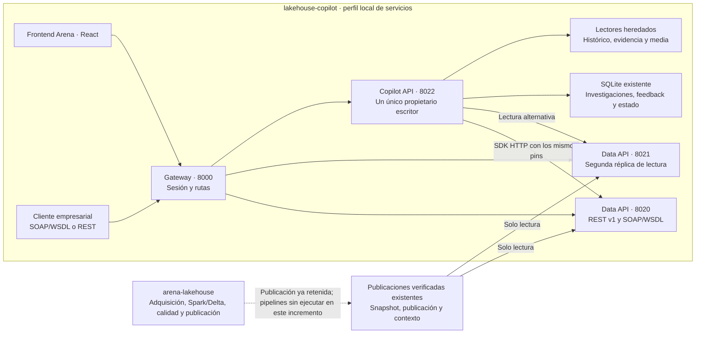

# Arquitectura de Arena

**Objetivo:** presentar Arena como un producto reproducible que demuestre
ingeniería de datos y software, creación de APIs REST y SOAP/WSDL, separación de
servicios, autenticación local, trazabilidad entre procesos y escalabilidad de
lecturas respaldada por mediciones. El frontend debe permitir investigar una
captura concreta y explicar sus estadísticas conservando la evidencia.

La prioridad del **19 de octubre de 2026** comprende la arquitectura completa.
El diseño, los contratos, el launcher y las evidencias de ejecución se mantienen
en la [arquitectura de servicios del consumidor](https://github.com/Manuelma4/lakehouse-copilot/blob/checkpoint/2026-10-08-reprise/docs/service-architecture.md).
Ambos repositorios continúan en `checkpoint/2026-10-08-reprise`.

La [entrega verificada del consumidor](https://github.com/Manuelma4/lakehouse-copilot/blob/checkpoint/2026-10-08-reprise/docs/SERVICE_ARCHITECTURE_2026-10-19.md)
conserva los resultados de navegación, autenticación, trazas, fallos y medición.
Este incremento no cambia pipelines ni ejecuta el productor.

## Fronteras y conexiones

| Componente | Responsabilidad y propiedad |
| --- | --- |
| `arena-lakehouse` | Produce, reconstruye y verifica datos; publica versiones y sus procedencias |
| Data API | Lee publicaciones existentes y sirve contratos REST y SOAP; dos procesos comparten esas publicaciones inmutables |
| Copilot API | Conserva un único escritor del estado SQLite; el resumen de estadísticas consume Data API mediante HTTP |
| Gateway | Sirve el frontend, verifica la sesión y dirige cada petición usando credenciales internas separadas |
| Frontend Arena | Presenta fuentes, partidos, equipos y explicaciones de la captura seleccionada |

El frontend y los servicios pertenecen a `lakehouse-copilot`. La separación es
incremental: Copilot todavía conserva lectores heredados para los recorridos
pendientes de migración. Un segundo Copilot escritor requiere resolver antes
la persistencia compartida. Las dos réplicas Data siguen dependiendo del mismo
equipo y almacenamiento; esta topología local no demuestra alta disponibilidad
distribuida ni escalabilidad en producción.

## Contratos y recorrido demostrable

Las lecturas Current migradas entran por `/api/live/...` y llegan a Data bajo
`/v1/live/...`. `/api/data/source`, `/api/data/match` y `/api/data/team` exponen
consultas versionadas. `/soap/arena?wsdl` describe `GetSourceInfo`, `GetMatch` y
`GetTeamStatistics`, respaldados por la misma evidencia de dominio.

El recorrido de explicación conecta frontend → gateway → Copilot → Data API.
`POST /api/v1/research/team-summary` transmite los tres fingerprints de la
selección y devuelve un resumen determinista con citas, `model=null` y
`saved=false`. Las investigaciones guardadas existentes conservan su recorrido
y su propietario de estado. El fútbol utiliza goles reglamentarios de 90 minutos
para esas estadísticas; VALORANT utiliza mapas de la serie.

Un conflicto de versión conserva HTTP 409. El cambio de réplica mantiene los
mismos pins; no permite sustituir silenciosamente la captura seleccionada.
Las lecturas pueden intentar una segunda réplica ante transporte o HTTP 503;
las escrituras y llamadas SOAP POST no se reintentan automáticamente.

## Seguridad, operación y evidencia

El perfil enlaza sus procesos a `127.0.0.1`, utiliza credenciales distintas para
gateway, Data y Copilot, y una sesión web firmada con cookie `HttpOnly` y
`SameSite=Strict`. Los secretos permanecen en archivos privados ignorados por
Git. La autorización local de un propietario no equivale a cuentas empresariales,
permisos por usuario, TLS ni OIDC.

`X-Request-ID` y `traceparent` enlazan las fronteras. Los endpoints autenticados
de operaciones muestran métricas y trazas acotadas en memoria. Los contratos
OpenAPI se consultan a través del gateway. La comparación reproducible de una
y dos réplicas debe informar latencia, peticiones por segundo y errores, junto
con la configuración y las limitaciones del equipo.

La validación del runtime local está registrada en el checkpoint del consumidor.
Sus informes de arranque, navegador, SOAP, preservación de estado y rendimiento
son la referencia para los resultados. Este documento del productor establece
responsabilidades; no añade una ejecución de sus pipelines.

## Continuación y traslado

1. Leer primero la arquitectura del consumidor y sus evidencias de entrega.
2. Verificar la disponibilidad local de las publicaciones y del estado existente
   antes de iniciar el perfil de servicios.
3. Revisar el recorrido completo en ambos deportes, los contratos y las trazas;
   registrar los resultados de la medición de réplicas con su alcance real.
4. Conservar un traspaso reproducible con los comandos, versiones y limitaciones
   antes de ampliar las fronteras o la infraestructura.

El alcance actual utiliza herramientas y fuentes gratuitas, conserva las
capturas y no incluye nueva ingestión, consultas a proveedores, instalación o
pruebas de Ollama, despliegues ni activación de GitHub Actions. Spark/Databricks
y los demás hitos históricos mantienen sus evidencias y pendientes propios.

`git pull` recupera código y documentación. Los datos privados, `.env`, tokens,
media, companions opcionales, investigaciones y bases SQLite ignoradas requieren
disponibilidad o recuperación local independiente. La ausencia de un companion
debe mostrarse como ausencia; Git no lo reconstruye ni autoriza una adquisición.
