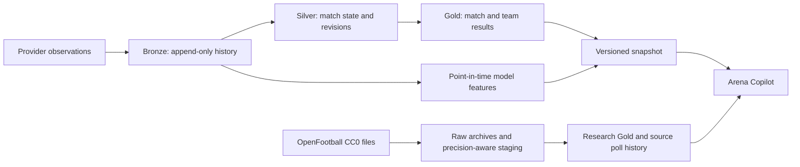

# Arena Lakehouse

**A data platform for football and competitive VALORANT match records.**

[Research application](https://manuelma4.github.io/lakehouse-copilot/) ·
[Arena Copilot](https://github.com/Manuelma4/lakehouse-copilot) ·
[Architecture and evidence](docs/evidence/README.md)

Match data changes after it arrives. Results are corrected, fixtures move, and
the same observation can be delivered more than once. Arena Lakehouse preserves
those observations and turns them into consistent match history, team statistics
and reproducible model inputs.

The repository contains the data layer of Arena. Its companion application reads
published snapshots rather than tables that may be in the middle of an update.

## Data flow

The execution layer uses Spark 4.1 and Delta Lake. File streaming, persistent
checkpoints, MERGE and Change Data Feed handle incremental observations. Late
changes update the affected matches and team aggregates. A failed stage is
recorded and resumed before a new snapshot can be published.

An independent Python reference calculation checks the Spark output. That
comparison covers current state, revision intervals and team totals, including
score corrections, cancelled results and renamed teams.

## Design decisions

| Concern | Approach |
|---|---|
| Identity | Provider-scoped match IDs and stable team IDs |
| Time | Separate kickoff, completion and observation timestamps in UTC |
| Open-data precision | Preserve source calendar dates and local wall times until a UTC instant can be established |
| Replay | Duplicate observations leave canonical results unchanged |
| Recovery | Persisted stage attempts; incomplete runs block publication |
| Quality | Schema and result validation with preserved quarantine records |
| Forecasts | Pre-match Elo and form; chronological train/validation/test windows |
| Delivery | Immutable Parquet/JSON snapshot with contract version and checksums |

Football scores represent goals. VALORANT scores represent maps won in a series.
The prediction baseline produces football win/draw/loss probabilities and
VALORANT series-win probabilities. Its features use results completed and
observed before the relevant cutoff.

## Validation

The [incremental scenario](docs/evidence/incremental-report.json) verifies replay,
backfill, late corrections and recovery against the independent reference. It
also checks that unaffected team rows retain their values and audit timestamps.
The [layout experiment](docs/evidence/layout-benchmark-report.json) records file
counts, bytes, executed plans and query timings with identical results. Its small
fixture and caching effects are documented with the measurements.

GitHub Actions runs the software suite and an independently triggered Linux
Spark workflow. The [Databricks profile](docs/databricks-profile.md) provides
Auto Loader, Spark Declarative Pipelines, AUTO CDC and a Lakeflow Job configuration;
managed workspace execution is still pending verification.

## Project scope

The public showcase contains 600 original synthetic matches, 16 teams and six
fictional competitions. An independent no-token OpenFootball collector and
research publisher add real community records from nine competition editions:
2,727 matches, 1,088 observed results and 1,639 unknown results in the recorded
import. Source files cover different seasons and may have incomplete results.

The [OpenFootball path](docs/openfootball-research.md) preserves raw checksums,
collection-time availability, corrections and unresolved source clocks. It
publishes a dedicated research contract rather than inventing UTC kickoff or
regulation-time prediction targets. These CC0 records can enter the public
research application; forecasting remains unavailable for this package.

Optional adapters support football-data.org and PandaScore observations.
Authenticated provider data stays separate from the public fixture.

Synthetic results validate the engineering workflow, not predictive accuracy on
real teams. The model remains uncalibrated. Course correspondence and remaining
engineering work are recorded in the [roadmap](ROADMAP.md); the snapshot interface
is defined in [CONTRACT.md](CONTRACT.md).

Original code and fictional data are licensed under MIT. Third-party data retains
its provider's terms. OpenFootball data and schema are
[CC0-1.0](https://github.com/openfootball/football.json/blob/master/LICENSE.md).
