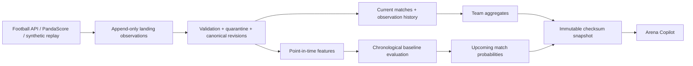

# Arena Lakehouse

[](https://github.com/Manuelma4/arena-lakehouse/actions/workflows/test.yml)

[Explore the live companion demo](https://manuelma4.github.io/lakehouse-copilot/) ? [Course roadmap](ROADMAP.md) ? [Measured evidence](docs/evidence/README.md)

**Football + professional VALORANT, from API observations to reproducible team intelligence.**

A Data Engineering portfolio lab with two deliberately separate execution paths:
a fast Python/SQLite/Arrow reference pipeline and a real Spark/Delta replay backend.
Its companion [Arena Copilot](https://github.com/Manuelma4/lakehouse-copilot) reads immutable
snapshots, explains the evidence, and displays independently computed model probabilities.

**Current milestone: 0.2.0 — incremental operations.** This is a multi-session learning
project. See [ROADMAP.md](ROADMAP.md) for completed capabilities, acceptance gates
and the remaining Databricks course coverage. A green software test is not a
claim of real-world predictive accuracy or production readiness.

## Try the offline demo

Python 3.11, no account, API token or Java needed for the reference demo:

```powershell
py -3.11 -m venv .venv
.\.venv\Scripts\python.exe -m pip install -e ".[dev]"
.\.venv\Scripts\arena-lakehouse.exe demo --matches 600 --seed 42
.\.venv\Scripts\python.exe -m pytest -q
```

On Linux/macOS, use `python3.11`, `.venv/bin/python` and `.venv/bin/arena-lakehouse`.
The demo generates original fictional teams for both sports, shuffled source
revisions, duplicate deliveries and malformed results. No real team performance
is represented. Keep synthetic and API workspaces separate.

## Architecture



The reference backend is an independent correctness oracle, not a substitute
marketed as Spark. The Spark backend actually runs file Structured Streaming,
`AvailableNow`, Delta MERGE, Change Data Feed, checkpoint restart, a late result
correction, revision history and Gold aggregation. Its output is compared against
the reference calculation. The persistent incremental runner now maintains only
affected match/history and team keys, supports bounded availability-time backfills,
soft-deletes empty aggregates, and resumes after a failure between layer commits.
Full reconstruction remains an independent correctness check. See
[incremental operations](docs/incremental-operations.md) for runnable commands.

## Run Spark/Delta

Requires Docker Desktop with Linux containers. The image contains Python 3.11,
Java 17, Spark 4.1.3 and the **Spark 4.1-specific Delta 4.4.0 JVM artifact**.

```powershell
docker build -t arena-lakehouse:0.2.0 .
$snapshot = Get-Content .\data\demo\snapshots\LATEST
$data = (Resolve-Path .\data).Path
docker run --rm --memory 6g --cpus 2 --mount "type=bind,source=$data,target=/data" arena-lakehouse:0.2.0 --snapshot "/data/demo/snapshots/$snapshot" --output /data/spark-smoke-new
```

Use a fresh output directory for each smoke so prior evidence is preserved.
Normal checkpoint restart is tested inside the run. [Measured evidence](docs/evidence/README.md)
records the environment and actual results.

The new `arena-spark` runner also provides `scenario`, `replay`, `backfill`,
`resume`, `export` and `benchmark`. Run it in the same container with
`--entrypoint arena-spark`. The measured scenario includes a late score correction,
cancelled sole result, postponed kickoff, team rename and a failed Silver/Gold
handoff. A separate file-layout experiment records identical results, actual
plans, bytes and query timings. Its small fixture is not a scale claim.

## Optional Databricks target

The [managed profile](docs/databricks-profile.md) includes a configurable
serverless SDP/Auto Loader/AUTO CDC graph and a two-task Lakeflow Job bundle.
It reuses the verified local Spark team aggregation and has no schedule.
Official CLI 1.19.0 JSON Schema validation passed locally. Workspace deployment,
permissions and managed runtime behavior remain **pending verification**.

## Optional free API ingestion

Copy `.env.example` to `.env`, supply your own free tokens, and never commit it.

```powershell
.\.venv\Scripts\arena-lakehouse.exe --workspace data/real collect --provider football-data --competition PL
.\.venv\Scripts\arena-lakehouse.exe --workspace data/real collect --provider pandascore --pages 1
.\.venv\Scripts\arena-lakehouse.exe --workspace data/real poll --provider football-data --cycles 3 --interval 300
```

Football defaults to Premier League (`PL`); `FL1` selects Ligue 1 where your free
account permits it. PandaScore requests VALORANT past/upcoming/running match endpoints,
not paid rounds or player statistics. Collection changes become replayable match
events. The cursor advances only after the canonical transaction succeeds.
Unnormalized JSON bodies are preserved in private `provider_raw` archives before
validation, and network failures retry within a fixed request budget.

Free access is polling, not a guaranteed real-time push feed. Credentials and
account coverage have not been verified against a user's live account. See
[provider notes](docs/providers.md) for official references and access boundaries.
Downloaded historical results become available at collection time; we do not
invent historical observation timestamps to manufacture a backtest.

## Model baseline

Two separate logistic models: football **A/draw/B** and VALORANT **A/B series winner**.
Inputs: pre-match Elo difference, last-five form difference and capped history
counts. Results must have completed and been observed before the cutoff. Training,
validation and test windows are chronological; equal kickoff times stay together.
The report includes frequency-baseline comparisons, accuracy, log loss and Brier
score. Probabilities are uncalibrated. Synthetic performance validates the workflow,
not predictive skill on real teams. Missing eligible history produces an explicit
unavailable status rather than a fabricated forecast.

## Development

`demo`, `replay`, bounded `backfill`, `export`, `collect` and `poll` are implemented
in the reference CLI; `benchmark` invokes actual Linux Spark. Persistent stages
and recovery use `arena-spark`. Managed workspace acceptance, roster SCD2,
calibration and larger controlled benchmarks remain roadmap work.
The snapshot format is documented in [CONTRACT.md](CONTRACT.md).
See [NEXT_SESSION.md](NEXT_SESSION.md) for the verified checkpoint and next tasks.

MIT licenses original code and fixtures. Third-party data and model weights retain
their own terms. No API data or licensed logos are committed.
