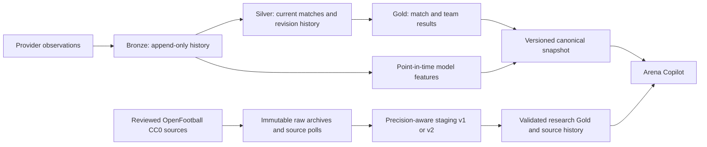

# Arena Lakehouse

**A versioned data platform for football and competitive VALORANT research.**

[Research application](https://manuelma4.github.io/lakehouse-copilot/) |
[Arena Copilot](https://github.com/Manuelma4/lakehouse-copilot) |
[Architecture and measured evidence](docs/evidence/README.md)

Match observations arrive out of order. Scores are corrected, fixtures move and
providers deliver the same event more than once. Arena Lakehouse preserves those
observations, maintains consistent match history and team aggregates, and publishes
immutable datasets for the companion research application.

Version **0.5.0** adds the men's World Cup 2026 through a pinned, no-token CC0
source and an explicit precision-aware research contract. The existing Spark/Delta
pipeline and original football/VALORANT showcase remain independently reproducible.

## Published datasets

| Dataset | Recorded coverage | Research boundary |
| --- | --- | --- |
| Original sports showcase | 600 synthetic matches, 16 teams, six fictional competitions | Engineering and model demonstrations on original data |
| OpenFootball research v2 | 2,831 matches, 261 derived teams, ten competition editions | Community source observations; incomplete results remain explicit |
| World Cup 2026 within research v2 | 104 matches, 48 national teams, 104 numeric-offset kickoff clocks | Pinned source facts with separate FT, extra-time and shootout score stages |

The real-data package contains 1,192 observed results and 1,639 unknown results.
Its identity is `20d06e8e5af0886e`, with observation cutoff
`2026-10-06T12:19:31.263499Z`. Coverage spans different source seasons; it does
not represent a complete live feed or official standings.

## Architecture

The canonical execution layer uses Python, Spark 4.1.3 and Delta Lake 4.4.0.
AvailableNow file streaming, persistent checkpoints, MERGE and Change Data Feed
handle incremental observations. Late changes update affected matches and team
aggregates. A persistent stage ledger records attempts and supports recovery;
incomplete runs cannot publish snapshots. An independent Python reconstruction
checks current state, revision intervals and aggregates.

The open-data path uses bounded HTTP acquisition, checksum-addressed archives,
SQLite revision state and typed Parquet/JSON publication. It publishes a separate
research contract, preserving source precision rather than forcing incomplete
records into the canonical timestamp contract.

## Engineering decisions

| Concern | Implemented behavior |
| --- | --- |
| Identity | Provider-scoped canonical IDs; reviewed source namespaces distinguish clubs from national teams |
| Source precision | Preserve original calendar date and local clock; derive UTC kickoff only from an explicit supported numeric offset |
| Replay and correction | Repeated inputs preserve match/history state; numbered source identities survive schedule or opponent corrections |
| Audit and recovery | Immutable observations, persistent attempts, measured poll history and preserved quarantine evidence |
| Publication integrity | Versioned schemas, typed Parquet/JSON parity, checksums and deterministic logical dataset identity |
| Pinned-source authenticity | Published World Cup business fields must match the bundled checksum-verified source, including scores, opponents, dates and grounds |
| Compatibility | Genuine v1 packages and stores remain supported without automatic migration or fixture rewriting |

Football scores represent goals; VALORANT scores represent maps won in a series.
The synthetic prediction baseline uses chronological splits and results completed
and observed before each cutoff. Its measurements do not establish predictive
accuracy on real teams.

Real research records retain unknown completion times and disabled forecasting.
An exact kickoff offset does not establish historical availability. World Cup
FT, extra-time and shootout source stages remain separate; the documented
JSON/TXT clock disagreement is preserved as a source limitation.

## Measured verification

The [v0.5 acquisition report](docs/evidence/openfootball-acquisition-v0.5.json)
records nine verified club archives replayed into a new workspace and one actual
pinned World Cup HTTP collection. Replaying all ten inputs produced zero new
revisions and identical current/history content, with zero quarantine.

The [v0.5 software report](docs/evidence/openfootball-software-verification-v0.5.json)
records the final offline suite, independent hostile-source mutation tests, code
checks and an isolated installed-wheel smoke. The actual v1 nine-source package
still reproduces its original manifest and every payload checksum; a dry replay
left the original SQLite bytes unchanged.

The earlier [incremental scenario](docs/evidence/incremental-report.json) verifies
late corrections, cancellation, backfill and failure recovery against the full
reference. The [layout experiment](docs/evidence/layout-benchmark-report.json)
records file counts, executed plans and query timings with identical results.
These retain their original measured configurations; v0.5 introduces no new
Spark throughput or production-scale claim.

GitHub Actions checks the software and provides a separately triggered Linux
Spark workflow. The [Databricks profile](docs/databricks-profile.md) includes Auto
Loader, Spark Declarative Pipelines, AUTO CDC and a Lakeflow Job configuration;
managed workspace execution remains pending verification.

## Project documentation

[World Cup source and v2 contract](docs/worldcup-research.md) |
[OpenFootball v1 research contract](docs/openfootball-research.md) |
[Canonical snapshot interface](CONTRACT.md) |
[Development guide](docs/development.md) |
[Engineering roadmap](ROADMAP.md)

Optional football-data.org and PandaScore adapters keep authenticated provider
data separate from the public showcase. The no-token OpenFootball path is usable
independently; authenticated provider calls still require separate verification.

Original code and fictional data use the MIT license. OpenFootball records retain
[CC0-1.0](https://github.com/openfootball/worldcup.json/blob/516d3825c3bd23fdc298c4014e84bde78f2d4965/LICENSE.md).
Other provider data remains subject to its provider's terms.
